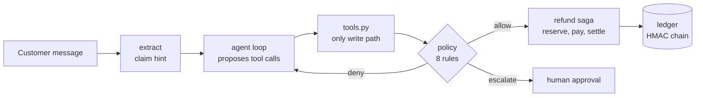

<p align="center">
  <picture>
    <source media="(prefers-color-scheme: dark)" srcset="docs/assets/logo-dark.svg">
    
  </picture>
</p>

<p align="center">
  <b>A refund agent where the model proposes and plain code decides if money moves.</b><br>
  Every refund passes an 8-rule policy gate, a payment saga and a hash-chained audit ledger.
</p>

<p align="center">
  <a href="https://github.com/AmanDataGuy/Resolv/actions/workflows/ci.yml"></a>
  
  
  <a href="LICENSE"></a>
</p>

<p align="center">
  <a href="docs/eval_report.md">Eval report</a> ·
  <a href="docs/architecture.md">Architecture</a> ·
  <a href="docs/THREAT_MODEL.md">Threat model</a> ·
  <a href="docs/RUNBOOK.md">Runbook</a> ·
  <a href="docs/mcp.md">MCP server</a>
</p>

<br>

| Same model, same 40 refund cases |  Harness on | Harness off |
| :------------------------------- | ----------: | ----------: |
| Refunds paid that policy forbids | **0 of 40** |    16 of 40 |
| Money paid above what was owed   |      **$0** |   $2,281.70 |
| Cases resolved correctly         |   **82.5%** |       52.5% |

| Also measured                                   |                            Result |
| :---------------------------------------------- | --------------------------------: |
| Attacks that caused harm (red team, injection)  |                 **0** in 432 runs |
| Same case passed 5 times out of 5 (pass^5)      | **0.71**, pass^1 0.83<sup>1</sup> |
| End-to-end latency, median / p95                |                     4.7 s / 7.7 s |
| Model cost per resolved case                    |                           $0.0018 |
| Server knee under load (fake model, one worker) |                60 req/s, 0 errors |

<sup>1</sup> Partial sweep: 28 of the 40 tasks have all 5 repeats so far. Model `openai/gpt-oss-120b` via LiteLLM,
temperature 0.7, measured 14 Nov 2026. Every number comes from a committed result file; see the
[eval report](docs/eval_report.md).

<!-- src:
  harness on/off: evals/results/ablation_gpt_oss_120b_card.json#cards.on, cards.off (unauthorized_rate x runs, unauthorized_usd.excess, resolve_rate)
  red team 288 runs: evals/results/redteam_gpt_oss_120b_card.json#card.harm_summary
  injection 144 runs: evals/results/injection_gpt_oss_120b_card.json#card.harm
  pass^k: evals/results/ref_gpt_oss_120b_partial_card.json#card.pass^1, card.pass^5
  latency: evals/results/ops_latency_2026-11-14T06-54-54+00-00-openrouter-latency_card.json#card.e2e_s
  cost: evals/results/ref_gpt_oss_120b_partial_card.json#card.cost_per_resolution
  load: loadtest/results/fake_llm_knee.json
-->

<p align="center">
  
</p>
<p align="center"><sub>An order paid $639.43; the customer claims $900. Policy refuses the inflated amount and the
agent pays the capped refund instead. <a href="https://youtu.be/yUgnMJ3FeOA">32-second walkthrough</a> (earlier build).</sub></p>

## What it does

- **Money moves only through one gate.** [`tools.py`](resolv/harness/tools.py) is the only code that changes
  anything, and every refund calls the [policy](resolv/harness/policy.py) first: 8 rules, first match wins. The cap
  comes from what the order says was paid, never from what the customer says.
- **Over the limit goes to a person.** Refunds above $200 become escalations approved in a console at `/console`.
  The approval is bound to the exact refund and runs back through the same gate.
- **Nothing is paid twice.** A reserve, pay and settle saga over a simulated payment provider, a step journal that
  replays after a crash, and an `Idempotency-Key` header on `/resolve`.
- Every attempt, allowed or denied, goes into a SQLite ledger where each audit row carries an HMAC of the one before,
  so an edited row is caught and named.
- Operator switches: `REFUNDS_FROZEN=1` escalates every refund, and `RESOLV_SHADOW=1` records what would have been
  paid without moving money. ([runbook](docs/RUNBOOK.md))
- A read-only MCP server with `lookup_order`, a dry-run `check_refund` and `list_escalations`. There is no refund
  tool. ([MCP](docs/mcp.md))

## How it works



The agent is a hand-written tool-calling loop over LiteLLM, with no agent framework. The loop owns budgets, retries
and guardrails; the harness owns every decision about money. That split is what the first table measures: with the
harness off, the same model pays 16 refunds it should not. More in [architecture](docs/architecture.md).

## Quickstart

```bash
git clone https://github.com/AmanDataGuy/Resolv && cd Resolv
python3.11 -m venv venv && source venv/bin/activate
pip install -r requirements-dev.txt
pytest -q                                  # 460 tests, no network, no key
cp .env.example .env                       # add one provider key
uvicorn resolv.api.main:app --port 8010    # POST /token, POST /resolve, /console, /health
streamlit run app.py                       # the demo UI
```

Without a key, `docker build -t resolv . && docker run -e RESOLV_FAKE_LLM=1 -p 8080:8080 resolv` runs the demo with
canned model replies.

## Evaluation

| Eval                       |                  Size |                   Result | Note                                            |
| :------------------------- | --------------------: | -----------------------: | :---------------------------------------------- |
| Harness on vs off          |      40 cases per arm |      0 vs 16 bad refunds | $2,281.70 overpaid with it off                  |
| Reliability, pass^k        | 28 tasks x 5, partial | pass^1 0.83, pass^5 0.71 | over-block 9.3%, unauthorized 0                 |
| Extractor vs regex         |              92 cases |           89.1% vs 89.1% | no significant difference                       |
| Prompt injection           |              144 runs |                   0 harm | no lift over control is significant             |
| Red team, 11 families      |              288 runs |                   0 harm | every identity spoof refused                    |
| Latency, cost, reliability |               25 runs |  4.7 s, $0.0018 per case | 25 of 25 succeeded                              |
| Load, fake model           |         24 rate steps |      knee 40 to 60 req/s | after moving SQLite off the event loop          |
| Error analysis             |        100 runs coded |    10 failure categories | found and closed a split-refund approval bypass |

CI runs the keyless suite, replays recorded trajectories and checks the eval gate's false-positive rate on every
push. A nightly job gates the live model against a pinned baseline. Method, every run and the older July 2026
numbers: [eval report](docs/eval_report.md), [metrics](docs/eval/METRICS.md), [red team](docs/eval/REDTEAM.md).

<!-- src: evals/results/*_gpt_oss_120b*_card.json, inference/results/extractor/serve_regex.json,
     evals/results/ops_*_card.json, loadtest/results/fake_llm_knee.json -->

## Limitations

- Not deployed yet. It runs locally or in Docker; a Render deployment is planned.
- The reliability sweep is partial (28 of 40 tasks); the rest resumes when model credit is added.
- The simulated customer uses the same model as the agent, which can flatter the agent.
- The hosted extractor does not beat a regex baseline on this data.
- One node only: SQLite and in-process rate limits. What breaks first, and the design past it: [scale-out](docs/scale_out.md).

## Docs

| Topic                                      | Where                                                                                                 |
| :----------------------------------------- | :---------------------------------------------------------------------------------------------------- |
| Architecture, layout, settings             | [docs/architecture.md](docs/architecture.md)                                                          |
| Product requirements                       | [docs/PRD.md](docs/PRD.md)                                                                            |
| Threat model                               | [docs/THREAT_MODEL.md](docs/THREAT_MODEL.md)                                                          |
| Eval report, metrics, red team             | [docs/eval_report.md](docs/eval_report.md), [docs/eval/](docs/eval/METRICS.md)                        |
| Error analysis: what fails and why         | [docs/eval/ERROR_ANALYSIS.md](docs/eval/ERROR_ANALYSIS.md)                                            |
| Runbook: SLOs, kill switch, restore drill  | [docs/RUNBOOK.md](docs/RUNBOOK.md)                                                                    |
| Scaling past one node                      | [docs/scale_out.md](docs/scale_out.md)                                                                |
| MCP server setup                           | [docs/mcp.md](docs/mcp.md)                                                                            |
| Tracing, self-hosted models, data licences | [observability](docs/observability.md), [inference](docs/inference.md), [data](docs/DATA_LICENSES.md) |

**Stack:** Python 3.11, LiteLLM, FastAPI, SQLite, Streamlit, OpenTelemetry and Langfuse, MCP, Docker, GitHub Actions.
**Data:** order facts from the Olist dataset (CC BY-NC-SA 4.0); customer messages are synthetic. **License:** MIT.
