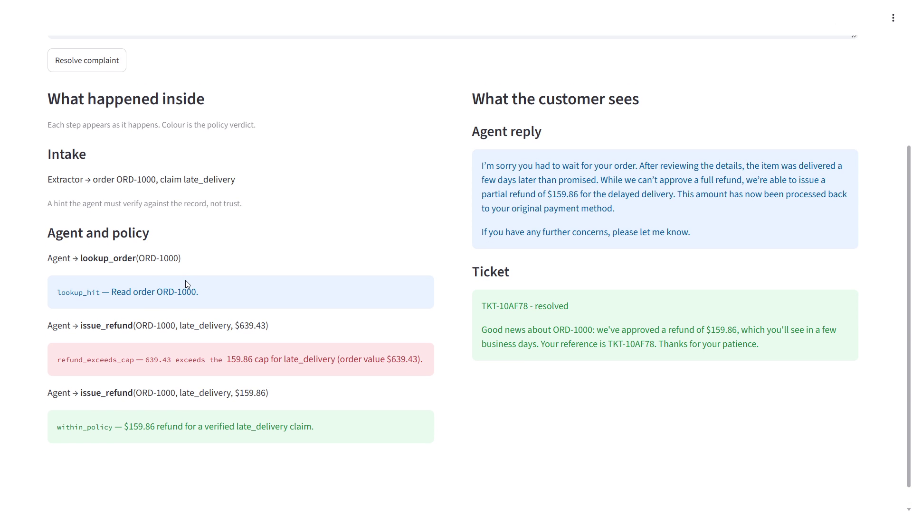
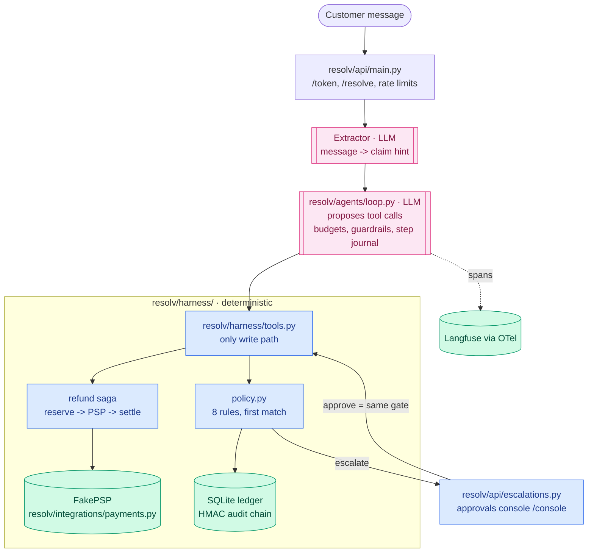

# Resolv

**A refund agent that moves money safely.** The language model reads the complaint and proposes tool calls; plain
Python decides whether any money moves. Every attempt, allowed or denied, lands in a keyed, hash-chained ledger
that the evals then grade.



<sub>A real order paid $639.43; the customer claims $900. The policy engine refuses the inflated amount and the agent
pays the capped refund instead. ▶ <a href="https://youtu.be/yUgnMJ3FeOA">32-second walkthrough</a> (recorded on an
earlier build).</sub>

---

## The idea: the model proposes, the harness disposes

- [`resolv/harness/tools.py`](resolv/harness/tools.py) is the only code that changes anything. Every refund calls
  [`resolv/harness/policy.py`](resolv/harness/policy.py) `check_refund` first, inside one ledger transaction.
- The policy is **eight rules (0-7)**, first match wins. The refund cap comes from what the order record says was
  paid, never from what the customer says, so an inflated claim is refused by arithmetic.
- A denial is a string the agent explains to the customer, not an exception.
- Anything over the agent's authority ($200 by default) becomes an escalation that a human approves or denies in a
  console. The approval is bound to the exact refund and runs back through the same gate.

## Tech stack

| Layer | Choice |
|---|---|
| Agent | Google ADK + LiteLLM, hand-written tool schemas, one model per role (agent, extractor, simulator, judge) |
| Models | Groq `gpt-oss-120b` by default; OpenRouter, Gemini (opt-in) or any self-hosted OpenAI-compatible server (vLLM, llama.cpp) |
| API | FastAPI + Uvicorn, HMAC tokens, per-IP rate limits, wall-clock timeouts |
| Storage | SQLite ledger: HMAC-chained audit trail, refunds, escalations, idempotency keys, outbox, step journal |
| Payments | FakePSP: a simulated payment provider with seeded faults, driven by a reserve -> pay -> settle saga |
| Observability | OpenTelemetry GenAI spans exported to Langfuse 4.x; PII masked |
| UI | Streamlit demo; static HTML/JS approvals console |
| Evals | pass^k with a simulated adversarial customer, task-clustered bootstrap CIs, deepeval GEval tone judge |
| Quality | pytest (433 keyless tests + 2 key-gated LLM tests), ruff, GitHub Actions CI and a capped nightly eval |

## Architecture



| Part | What it does |
|---|---|
| Policy gate ([`policy.py`](resolv/harness/policy.py)) | Eight rules over the order record, the caller and the refund history. Returns allow / deny / escalate with a rule id. |
| Ledger ([`ledger.py`](resolv/harness/ledger.py)) | One SQLite file (`RESOLV_DB`, default `data/resolv.db`). Each audit record carries an HMAC over the previous one (`AUDIT_HMAC_KEY`). A partial UNIQUE index allows one live refund per order. |
| Refund saga ([`tools.py`](resolv/harness/tools.py), [`payments.py`](resolv/integrations/payments.py)) | Reserve a pending refund, call the payment provider, then settle, compensate on a decline, or park as `unknown` for the reconciler that runs every 30 s. |
| Human approvals ([`escalations.py`](resolv/api/escalations.py), [`web/console/`](web/console)) | List, inspect, approve or deny escalations at `/console`. Approvers see the raw bound action and its hash, and can't approve their own refund. |
| Durable steps ([`loop.py`](resolv/agents/loop.py)) | Each completed step is journaled; re-running a case replays the journal, so a crash mid-refund still pays once. Demo: `python scripts/crash_resume_demo.py`. |
| Guardrails ([`guardrails.py`](resolv/harness/guardrails.py), [`pii.py`](resolv/harness/pii.py)) | Replies are checked for prompt leaks, PII and promises the trail didn't earn; PII is masked before the LLM in prod. |
| Identity ([`auth.py`](resolv/api/auth.py)) | A customer gets a session token only by showing an order's proof code. Approver tokens are minted locally only. |
| Tracing ([`observability.py`](resolv/observability.py)) | One span per run, LLM call and tool call. No keys = no network. Schema: [`docs/observability.md`](docs/observability.md). |

More: [`docs/PRD.md`](docs/PRD.md), [`docs/THREAT_MODEL.md`](docs/THREAT_MODEL.md),
[`docs/RUNBOOK.md`](docs/RUNBOOK.md), [`docs/eval_report.md`](docs/eval_report.md), [`docs/inference.md`](docs/inference.md).

## Layout

| Path | What lives there |
|---|---|
| `resolv/` | The app package: `config.py`, `schemas.py`, `observability.py`, `monitor.py`, `invariants.py`, `agents/` (extractor, loop, llm), `api/` (main, auth, escalations, ratelimit), `harness/` (policy, tools, ledger, audit, validity, guardrails, pii, routing), `integrations/` (payments, notify) |
| `evals/` | Eval entry points (`python -m evals.<name>`), `baselines/`, `fixtures/`, `regression/`, `results/` |
| `inference/` | `serve_local.sh` (vLLM / llama.cpp on a local GPU) and `serve_bench.py` (self-hosted extractor vs regex) |
| `scripts/` | Dataset generation, frozen simulator openings, cassette recording, crash-resume demo, extractor fine-tune |
| `loadtest/` | Concurrent load test against `/resolve` |
| `web/console/` | Approvals console served at `/console` |
| `tests/` | Keyless pytest suite |
| `docs/` | PRD, threat model, runbook, eval report, metrics, red team, observability, inference, data licences |
| `app.py` | Streamlit demo |

---

## Run it

```bash
python -m venv venv && venv\Scripts\activate      # Windows; source venv/bin/activate elsewhere
pip install -r requirements-dev.txt
cp .env.example .env                               # add one provider key

pytest -q -p no:cacheprovider     # keyless suite: no network, no API key
python -m resolv.harness.policy   # the eight rules against the real order DB

uvicorn resolv.api.main:app       # POST /token, POST /resolve, /console, /health
streamlit run app.py              # the demo UI
```

Key variables (full list in [`.env.example`](.env.example)):

| Variable | Purpose |
|---|---|
| `GROQ_API_KEY` / `OPENROUTER_API_KEY` / `GEMINI_API_KEY` | One key per provider. Gemini is used only with `LLM_PROVIDER=gemini`. |
| `LLM_PROVIDER`, `LLM_MODEL` | Provider and default model for every role. |
| `AGENT_MODEL`, `EXTRACTOR_MODEL`, `SIMULATOR_MODEL`, `JUDGE_MODEL` | Per-role override; `selfhosted:<name>` points a role at `SELFHOSTED_BASE_URL`. |
| `RESOLV_ENV` | `dev` / `test` / `eval` / `prod`. `prod` requires the auth secrets (fails closed) and masks PII before the LLM. |
| `AUTO_APPROVE_MAX_USD`, `CLAIM_WINDOW_DAYS` | Policy thresholds ($200, 90 days). |
| `AUTH_SECRET`, `ORDER_PROOF_SECRET`, `AUDIT_HMAC_KEY` | Token, receipt-code and audit-chain secrets. Random per process in dev if unset. |
| `LANGFUSE_PUBLIC_KEY`, `LANGFUSE_SECRET_KEY`, `LANGFUSE_HOST` | Tracing. Blank = off. |
| `RESOLV_FAKE_LLM=1` | Canned model replies, for load tests and the crash demo. No key needed. |

Mint an approver token for the console (local only, needs the same `AUTH_SECRET` as the server):

```bash
python -m resolv.api.auth --mint-approver alice
```

Deployment: the [`Dockerfile`](Dockerfile) packages the Streamlit demo. No hosted API deployment is claimed here.

---

## Tests

433 keyless tests, no network and no API key: **433 pass**, including 6 recorded trajectories replayed from
`evals/regression/cassettes/`. Two more LLM tests in `tests/llm/` run only with a provider key (they pass on the Groq
free tier) and skip in CI. Run on 2026-11-04.

They cover each policy rule, the ledger and its hash chain, concurrent refunds (no double pay), payment faults and
reconciliation, crash-resume, approvals bound to the action hash, auth and input caps, reply guardrails and PII
masking, loop budgets and retries, and the eval maths itself. CI runs the same suite on every push.

## Evals and benchmarks

Each command writes per-case JSONL rows under `evals/results/`. Commands that call a model cost money on paid
tiers; estimate first.

| What | Command | Docs |
|---|---|---|
| pass^k sweep with a simulated adversarial customer | `python -m evals.runner --n 5 --tasks 40` | [METRICS](docs/eval/METRICS.md) |
| Nightly smoke gate | `python -m evals.runner --subset 8 --n 2 --k 1 --gate evals/baselines/agent_ref_groq.json` | [evals/baselines](evals/baselines/README.md) |
| Extractor accuracy and hallucination | `python -m evals.extractor --split test` | [METRICS](docs/eval/METRICS.md) |
| Prompt injection (control vs attack arms) | `python -m evals.injection` | [REDTEAM](docs/eval/REDTEAM.md) |
| Red team (attack families) | `python -m evals.redteam` | [REDTEAM](docs/eval/REDTEAM.md) |
| Harness ON vs OFF | `python -m evals.ablation` | [METRICS](docs/eval/METRICS.md) |
| Reply tone (GEval judge) | `python -m evals.quality` | [METRICS](docs/eval/METRICS.md) |
| Reliability / latency / cost | `python -m evals.reliability`, `python -m evals.latency`, `python -m evals.cost` | [METRICS](docs/eval/METRICS.md) |
| Drift on live traffic | `python -m evals.drift` | [RUNBOOK](docs/RUNBOOK.md) |
| Self-hosted extractor vs regex | `python -m inference.serve_bench --backend regex --label regex` | [docs/inference.md](docs/inference.md) |
| API load test | `python -m loadtest.resolve --order ORD-1187 --proof <code>` | [loadtest/README.md](loadtest/README.md) |

---

## Results

Only two result files are committed: [`evals/baselines/agent.json`](evals/baselines/agent.json) and
[`evals/baselines/extractor.json`](evals/baselines/extractor.json). Both are **historical**: Gemini 3.5 Flash, pinned
2026-07-25, before rule 2 (caller must own the order), the reply guardrails and the prompt change. Google now routes
that endpoint to a newer model, so they cannot be re-run as-is.

| Metric | Value | n | Source |
|---|---|---|---|
| pass^3 (agent sweep) | 0.9625 <!-- src: evals/baselines/agent.json#card.pass^3 --> | 40 tasks × 5 | agent.json, historical |
| unauthorized_rate | 0.0 <!-- src: evals/baselines/agent.json#card.unauthorized_rate --> | 200 runs | agent.json, historical |
| over_block_rate | 0.005 <!-- src: evals/baselines/agent.json#card.over_block_rate --> | 200 runs | agent.json, historical |
| resolve_rate (Wilson 95% CI) | 0.985 (0.957-0.995) <!-- src: evals/baselines/agent.json#card.resolve_rate,card.resolve_ci95 --> | 200 runs | agent.json, historical |
| Extractor both-correct (95% CI) | 0.9783 (0.924-0.994) <!-- src: evals/baselines/extractor.json#score.both_acc,score.both_ci95 --> | 92 | extractor.json, historical |
| Extractor hallucination rate | 0.1538 <!-- src: evals/baselines/extractor.json#score.hallucination_rate --> | 13 | extractor.json, historical (small n) |
| pass^k on the current default model | not yet re-measured | | |
| Harness ON vs OFF (ablation) | not yet re-measured | | |
| Injection lift over control | not yet measured | | |
| Red team harm | not yet measured | | |
| Reply tone | not yet re-measured | | |
| Latency, cost per resolution, reliability | not yet re-measured | | |
| Regex extractor both-correct (95% CI) | 0.891 (0.811-0.940) <!-- src: inference/results/extractor/serve_regex.json#card.both_acc,card.both_ci95 --> | 92 | serve_regex.json, 2026-11-04, no model |
| Regex extractor hallucination rate | 0.385 <!-- src: inference/results/extractor/serve_regex.json#card.hallucination_rate --> | 13 | serve_regex.json, 2026-11-04 (small n) |
| Load-test knee | not yet measured | | |

How the numbers are graded: the sweep replays each refund through `check_refund` **and** runs an independent
invariant checker ([`resolv/invariants.py`](resolv/invariants.py)), because a replay through the same policy code
would score a policy bug as "authorized". Details and caveats: [`docs/eval_report.md`](docs/eval_report.md).

### Fine-tuning: an honest negative result

A GRPO LoRA fine-tune of Qwen2.5-1.5B-Instruct on the extractor ([`scripts/train_extractor.py`](scripts/train_extractor.py))
was measured once on Kaggle at 0.489 → 0.707 both-correct; those rows were not kept. A prior audit measured a plain
regex extractor at 0.891 on the same split, and the hosted model scores 0.9783 <!-- src: evals/baselines/extractor.json#score.both_acc -->.
So the tuned adapter loses to both and is not served. Re-measuring regex and the adapter in-repo:
[`docs/inference.md`](docs/inference.md).

---

## Data

`data/db/orders.json` holds 460 orders derived from the Olist e-commerce dataset. The complaint messages in
`data/datasets/complaint_cases.json` are **LLM-generated** over those real orders; no real customer wrote them.
Licences and what still needs confirming: [`docs/DATA_LICENSES.md`](docs/DATA_LICENSES.md).

## Known limitations

- **Single node.** The ledger is one SQLite file and the rate limiter is in-process memory.
- **Payments are simulated** (FakePSP), and notifications write files under `data/outbox/`.
- **Synthetic complaints** and a simulated customer that uses the agent's own model family.
- **The clock is pinned** just after the last Olist order, or the claim-window rule would deny everything.
- **No idempotency key on `/resolve`.** A client retry runs a new case; the ledger still allows one live refund per order.
- **The tone judge is not calibrated** against human labels.
- **Audit chain limit:** someone with DB write access *and* `AUDIT_HMAC_KEY` can rewrite history.
- **PII masking is regex**: it misses names and free-form addresses.
- **OWASP LLM Top 10 mapping** in the red team is pending verification.

## History

The first headline (pass^3 0.9625, Gemini 3.5 Flash) predates the caller-ownership rule, the reply guardrails, the
SQLite ledger and the saga. It is kept above as a historical row, not as a claim about the current system.

MIT licensed code; data licences in [`docs/DATA_LICENSES.md`](docs/DATA_LICENSES.md).
