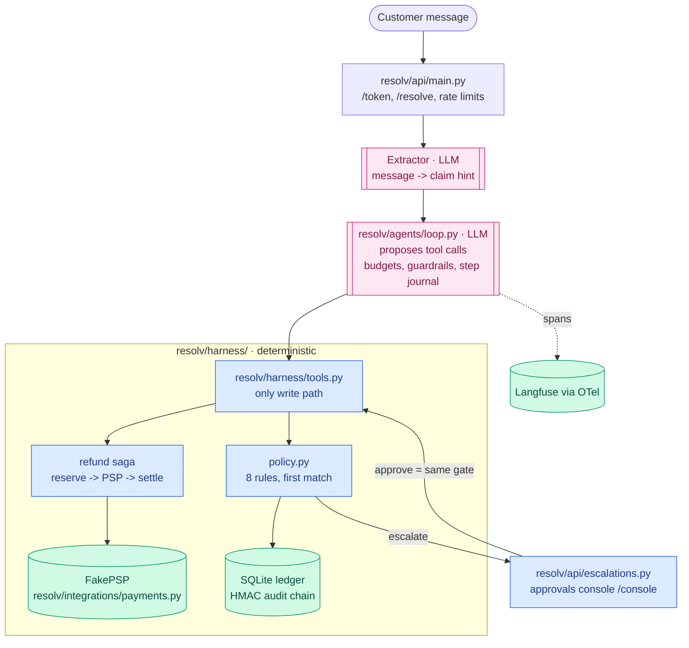

# Architecture

How Resolv is put together: the flow of one case, what each part does, where it lives, and the settings. The README
links here; measured numbers are in the [eval report](eval_report.md).

## Flow



| Part | What it does |
|---|---|
| Policy gate ([`policy.py`](../resolv/harness/policy.py)) | Eight rules over the order record, the caller and the refund history. Returns allow / deny / escalate with a rule id. |
| Ledger ([`ledger.py`](../resolv/harness/ledger.py)) | One SQLite file (`RESOLV_DB`, default `data/resolv.db`). Each audit record carries an HMAC over the previous one (`AUDIT_HMAC_KEY`). A partial UNIQUE index allows one live refund per order. |
| Refund saga ([`tools.py`](../resolv/harness/tools.py), [`payments.py`](../resolv/integrations/payments.py)) | Reserve a pending refund, call the payment provider, then settle, compensate on a decline, or park as `unknown` for the reconciler that runs every 30 s. |
| Human approvals ([`escalations.py`](../resolv/api/escalations.py), [`web/console/`](../web/console)) | List, inspect, approve or deny escalations at `/console`. Approvers see the raw bound action and its hash, and can't approve their own refund. |
| Durable steps ([`loop.py`](../resolv/agents/loop.py)) | Each completed step is journaled; re-running a case replays the journal, so a crash mid-refund still pays once. Demo: `python scripts/crash_resume_demo.py`. |
| Guardrails ([`guardrails.py`](../resolv/harness/guardrails.py), [`pii.py`](../resolv/harness/pii.py)) | Replies are checked for prompt leaks, PII and promises the trail didn't earn; PII is masked before the LLM in prod. |
| Identity ([`auth.py`](../resolv/api/auth.py)) | A customer gets a session token only by showing an order's proof code. Approver tokens are minted locally only. |
| Tracing ([`observability.py`](../resolv/observability.py)) | One span per run, LLM call and tool call. No keys = no network. Schema: [`docs/observability.md`](observability.md). |

## Repo layout

| Path | What lives there |
|---|---|
| `resolv/` | The app package: `config.py`, `schemas.py`, `observability.py`, `monitor.py`, `invariants.py`, `agents/` (extractor, loop, llm), `api/` (main, auth, escalations, ratelimit), `harness/` (policy, tools, ledger, audit, validity, guardrails, pii, routing), `integrations/` (payments, notify) |
| `evals/` | Eval entry points (`python -m evals.<name>`), `baselines/`, `fixtures/`, `regression/`, `results/` |
| `inference/` | `serve_local.sh` (vLLM / llama.cpp on a local GPU) and `serve_bench.py` (self-hosted extractor vs regex) |
| `scripts/` | Dataset generation, frozen simulator openings, cassette recording, crash-resume demo, extractor fine-tune |
| `loadtest/` | Concurrent load test against `/resolve` |
| `web/console/` | Approvals console served at `/console` |
| `tests/` | Keyless pytest suite |
| `docs/` | PRD, threat model, runbook, eval report, metrics, red team, observability, inference, data licences |
| `app.py` | Streamlit demo |

## Settings

Key variables (full list in [`.env.example`](../.env.example)):

| Variable | Purpose |
|---|---|
| `GROQ_API_KEY` / `OPENROUTER_API_KEY` / `GEMINI_API_KEY` | One key per provider. Gemini is used only with `LLM_PROVIDER=gemini`. |
| `LLM_PROVIDER`, `LLM_MODEL` | Provider and default model for every role. |
| `AGENT_MODEL`, `EXTRACTOR_MODEL`, `SIMULATOR_MODEL`, `JUDGE_MODEL` | Per-role override; `selfhosted:<name>` points a role at `SELFHOSTED_BASE_URL`. |
| `RESOLV_ENV` | `dev` / `test` / `eval` / `prod`. `prod` requires the auth secrets (fails closed) and masks PII before the LLM. |
| `AUTO_APPROVE_MAX_USD`, `CLAIM_WINDOW_DAYS` | Policy thresholds ($200, 90 days). |
| `AUTH_SECRET`, `ORDER_PROOF_SECRET`, `AUDIT_HMAC_KEY` | Token, receipt-code and audit-chain secrets. Random per process in dev if unset. |
| `LANGFUSE_PUBLIC_KEY`, `LANGFUSE_SECRET_KEY`, `LANGFUSE_HOST` | Tracing. Blank = off. |
| `RESOLV_FAKE_LLM=1` | Canned model replies, for load tests and the crash demo. No key needed. |

Mint an approver token for the console (local only, needs the same `AUTH_SECRET` as the server):

```bash
python -m resolv.api.auth --mint-approver alice
```
